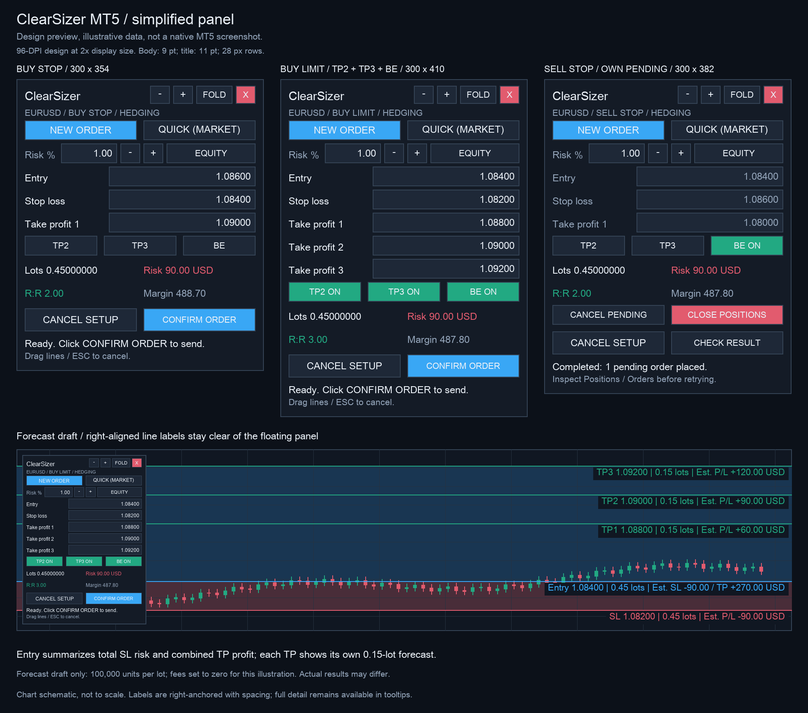

# ClearSizer4MT5

[中文](README.md)

ClearSizer v1.80 is an MT5 panel for planning trades on the chart and sizing them from a chosen risk percentage.



*Illustration with sample prices and amounts, not a native MT5 screenshot.*

## Install

This repository contains source files, without a compiled `.ex5`.

1. Download or clone the repository.
2. In MT5, choose **File → Open Data Folder**. Copy `MQL5/Experts/ClearSizer` into the data folder's `MQL5/Experts/` directory. Keep `ClearSizer.mq5` and `SizerTrade.mqh` together.
3. Press **F4**, open `ClearSizer.mq5` in MetaEditor, then press **F7** to compile. Resolve any errors before attaching it.
4. Refresh **Navigator → Expert Advisors** and attach ClearSizer to a chart.
5. Enable **Algo Trading** and the EA's trading permission when placing orders or using break-even. Start on a demo account.

No DLLs or external libraries are required. The panel starts empty and does not generate trading signals.

## Place an order

**NEW ORDER** starts a pending setup: click the main chart to fix **SL → Entry → TP1**. The first SL can be on either side of the current quote. Direction comes from SL relative to the planned Entry; Entry relative to the current Ask/Bid determines the pending type:

| Direction | Entry position | Order |
| --- | --- | --- |
| SL < Entry: BUY | Below Ask | BUY LIMIT |
| SL < Entry: BUY | Above Ask | BUY STOP |
| SL > Entry: SELL | Above Bid | SELL LIMIT |
| SL > Entry: SELL | Below Bid | SELL STOP |

Entry must be far enough from the quote and SL to meet the broker's distance rules. Pending SL/TP distances use the planned Entry. Invalid pending setups are rejected, never converted to market orders.

**QUICK** needs **SL → TP1**. SL below Bid selects BUY at Ask; SL above Ask selects SELL at Bid. A stop inside the spread or too close is rejected. Entry follows the quote and stays read-only.

Once the lines are placed, check Lots, Risk, R:R and Margin, then click **CONFIRM ORDER**. If the market has crossed a pending Entry and changed its Limit/Stop type, that click only updates the type. Check the new type and confirm again.

Edit prices or drag lines after drawing. Changing pending Entry/SL recalculates the order type; a direction change requires TP1 to be placed again. Draft edits leave existing trades unchanged.

With the chart focused, **ESC** clears any unsubmitted draft, including Ready. It also disarms a pending cancel/close confirmation. It does not cancel submitted orders or close positions. Finish editing a field and activate the chart if another control has keyboard focus. **CANCEL SETUP** also clears the draft; NEW ORDER or QUICK starts another.

## Targets and break-even

TP2, TP3 and BE share one row. Green controls marked ON are enabled. TP3 also enables TP2; turning TP2 off disables TP3. Before submission, the extra target prices appear above the buttons and can be edited.

On a hedging account, multiple targets become separate orders with the same SL and different TPs. Total volume is divided into broker-valid steps, with any remainder in the last leg. If a leg cannot meet minimum/maximum volume, the setup is rejected rather than enlarged.

**BE** tries to move SL to entry after a favorable **1R** move. R is the original entry-to-SL price distance: for a BUY at 100 with SL 90, Bid reaching 110 makes 100 the target SL. It only tightens the stop, keeps TP and does not trail afterward. Fees, swaps and slippage are not covered. Keep MT5 and the EA running with quotes and trading permission available.

## Reading the chart

Right-side labels show draft forecasts in account currency. Entry summarizes total volume, estimated SL loss and combined TP reward. SL uses total volume; each TP shows its own leg's volume and reward. These are not live floating P/L. Hover shortened labels for full details.

Red and blue zones cover the chart between SL, Entry and the furthest TP. The 300 × 354 default panel at 96 DPI supports zoom, folding and pagination. The red **X** removes the EA without closing trades; local BE then stops. Reloading or changing timeframe resets the draft and switches BE off.

## Account and execution details

Risk % applies to the current order group, not the whole account. Volume rounds down; a result below the broker minimum is rejected. `InpCostPerLot` adds an estimated round-trip cost per lot, default 0. Actual costs, fills and gaps can produce different results.

Netting accounts support one target and require the symbol to have no existing position or pending order. Mixed or unverifiable net positions are excluded from management. Cancel, close and BE use the current symbol plus `InpMagic`; use distinct IDs for independent panels. **CANCEL PENDING** and **CLOSE POSITIONS** each need a second click within eight seconds.

Each draft permits one submission attempt. A partial fill, rejection or unconfirmed market execution stops later legs, leaving accepted orders in place. After **CHECK RESULT**, inspect Trade/History and the Experts log before starting another setup.

## Tests and documentation

From the repository root, with Python 3 and a C++17-capable `clang++`:

```sh
python3 tests/test_trade_offline.py
python3 tests/test_drawing_offline.py
python3 tests/check_compact_layout.py
```

These offline checks use converted MQL logic and simulated platform APIs; they do not establish MetaEditor compilation or native MT5/broker behavior, which remain unverified.

[Full user guide (Chinese)](docs/USER_GUIDE.zh-CN.txt) · [Test notes](tests/README.md) · [Validation record](docs/VALIDATION.txt) · [Changelog](CHANGELOG.md)
