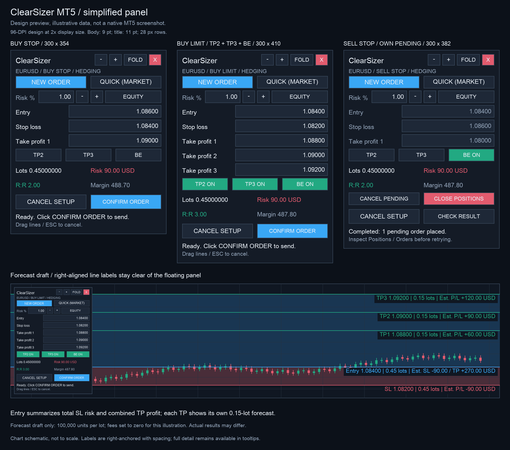

# ClearSizer4MT5

[English](README.en.md)

ClearSizer 是一个 MT5 仓位计算和下单面板。在图表上放好止损、入场和止盈，设定风险比例，面板会算出手数和预计盈亏。价格可以直接拖线调整，确认后再下单。

挂单用 **NEW ORDER**，市价单用 **QUICK**。买卖方向和挂单类型由价格线的位置决定，不用另外选择 BUY 或 SELL。



*界面示意图，使用示例数据，并非 MT5 实测截图。当前版本：1.80。*

## 安装

仓库提供源码，需要用 MetaEditor 编译：

1. 下载仓库，在 MT5 中打开 **File → Open Data Folder**。
2. 把仓库里的 `MQL5/Experts/ClearSizer` 文件夹复制到数据目录的 `MQL5/Experts/` 下。
3. 按 **F4** 打开 MetaEditor，打开 `ClearSizer.mq5`，按 **F7** 编译。
4. 回到 MT5，刷新 **Navigator → Expert Advisors**，把 ClearSizer 拖到图表。
5. 下单或使用 BE 时，打开 **Algo Trading**，并允许此 EA 交易。首次使用请先在模拟账户试单。

两个文件要放在一起：

```text
MQL5/Experts/ClearSizer/
├── ClearSizer.mq5
└── SizerTrade.mqh
```

无需 DLL 或额外库。一个图表只能加载一个 EA。

## 下单

### NEW ORDER：挂单

点击 NEW ORDER，然后在主图依次放置 **SL → Entry → TP1**。SL 低于 Entry 是买入，高于 Entry 是卖出。Entry 放好后，面板按当前报价选择挂单类型：

| 方向 | Entry 的位置 | 挂单类型 |
| --- | --- | --- |
| 买入 | 低于 Ask | Buy Limit |
| 买入 | 高于 Ask | Buy Stop |
| 卖出 | 高于 Bid | Sell Limit |
| 卖出 | 低于 Bid | Sell Stop |

第一步放 SL 时，它可以在当前价格任意一侧；最终方向要等 Entry 确定后才知道。Entry、SL 和 TP 仍须满足券商的价格距离要求。

### QUICK：市价单

点击 QUICK，只需放置 **SL → TP1**。SL 低于 Bid 时买入，高于 Ask 时卖出；Entry 自动使用对应的实时报价。SL 在点差内或距离太近时，需要重放。

### 确认与修改

画好后检查手数、风险和保证金，点击 **CONFIRM ORDER** 发送。若行情已越过挂单 Entry，导致 Limit/Stop 类型改变，面板会先显示新类型，等你再确认一次。

画好后可以输入价格，或双击选中价格线后拖动。改动 Entry 或 SL 后会重新判断方向；方向变了，就要重新放 TP。

按 **ESC** 或点击 **CANCEL SETUP** 可以取消尚未提交的设置，包括已显示 Ready 的状态。ESC 需要图表获得键盘焦点；正在输入价格时，先结束编辑。已提交的订单不受影响。

每份设置只发送一次。提交后显示 **CHECK RESULT**；如果只成交了一部分，或返回结果不明确，先看 MT5 的 Trade/History 和 Experts 日志，再决定下一步。

## 风险与多段止盈

Risk % 按余额（BALANCE）或净值（EQUITY）计算本次订单组的风险预算。旁边的 −/+ 每次调整 0.25 个百分点。手数向下取整到券商步长，预算不够最小手数时不会下单。

开启 **TP2 / TP3** 后，会自动增加止盈线和价格框。TP3 会同时开启 TP2；关闭 TP2 也会关闭 TP3。默认每段增加 TP1 距入场价的一半，例如 TP1 是 2R，后两段就是 3R、4R，也可以各自拖动。

- **HEDGING 对冲账户**：多段止盈拆成独立订单，共用 SL，各有 TP。手数尽量平均分，步长余数放在最后一笔；每笔都要满足券商最小、最大手数。
- **NETTING 净额账户**：只使用一个 TP。该品种已有仓位或挂单时，不再开新单；混入其他策略或手工成交的净仓，也不由面板接管。

多笔订单依次发送。中途拒单、部分成交或结果不明确时，会停止后续发送；已经接受的订单会保留，不会自动重发整组。

## BE 保本、撤单与平仓

点击 **BE** 开启保本：盈利达到初始止损距离的 **1R** 后，尝试把 SL 移到实际开仓价。例如买入价 100、初始 SL 90，Bid 到 110 时，目标 SL 为 100。之后不继续跟踪价格，关闭 BE 也不会把 SL 移回去。

BE 不包含手续费、隔夜费和滑点，调整时还要满足券商的止损、冻结距离。它需要 MT5 和 EA 持续在线，重载后默认关闭。

有本面板的仓位或挂单时，会显示 **CANCEL PENDING / CLOSE POSITIONS**。两者都要在 8 秒内再点一次确认，只处理当前品种、当前 `InpMagic` 的交易。平仓和撤挂单是两个独立操作。

## 图表读数和显示设置

价格线的文字在图表右侧：Entry 汇总总手数、SL 风险和全部 TP 收益；SL 显示总手数及预计亏损；每个 TP 显示那一笔的手数和预计盈利。红区是止损范围，蓝区是止盈范围，横向覆盖可见主图。

金额使用账户币种，属于下单前的估算。`InpCostPerLot` 可填写预计每手往返费用，默认 0；佣金、隔夜费、滑点和跳空仍可能让实际结果不同。尚未确定或不满足下单条件的数据显示 `--`。

提交后的读数保留当时的估算，实际成交和实时盈亏看 MT5 的 Trade/History。窄窗口会简化标签，完整内容可悬停查看。

顶部 −/+ 调整面板大小，FOLD 折叠，红色 X 移除 EA。X 不平仓、不撤单，但会停止本地 BE。字体或缩放不合适时，可调整 `InpFont`、`InpUIScale` 或 `InpDpiOverride`。

同一终端内，相同账户、品种和 `InpMagic` 只运行一个面板；独立使用时请设置不同的 Magic。切换周期、修改参数或重载 EA 会清空未提交设置，并关闭 BE。

## 开发与测试

从仓库根目录运行，需要 Python 3 和支持 C++17 的 `clang++`：

```sh
python3 tests/test_trade_offline.py
python3 tests/test_drawing_offline.py
python3 tests/check_compact_layout.py
```

测试使用模拟的券商和图表接口，检查交易逻辑与布局。MetaEditor 编译和实际 MT5/券商环境测试尚未在这里验证，具体范围见[验证记录](docs/VALIDATION.txt)和[测试说明](tests/README.md)。

更多操作细节见[使用指南](docs/USER_GUIDE.zh-CN.txt)，版本变化见[更新记录](CHANGELOG.md)。
